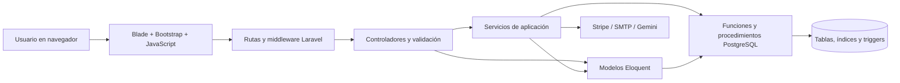
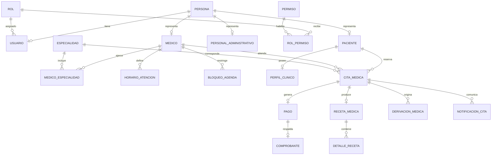
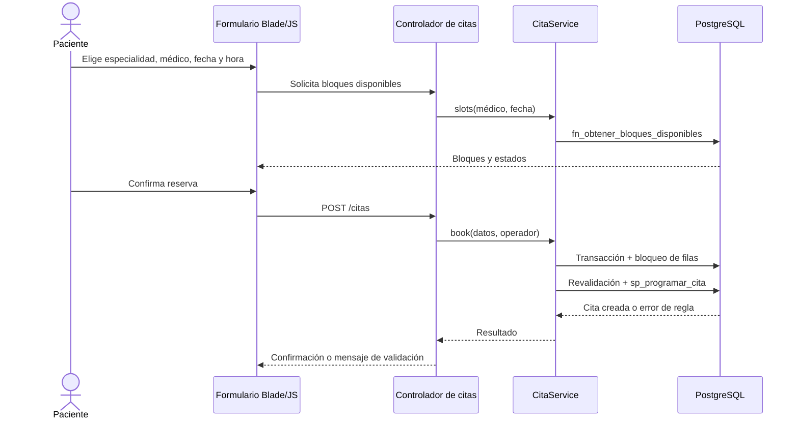

# Arquitectura y diseño del sistema Vida Nuevamente Segura

**Documento técnico de la implementación.** Actualizado el 25 de octubre de 2026.

## 1. Propósito y alcance

Vida Nuevamente Segura es una aplicación web para administrar la atención ambulatoria de una clínica. Integra el registro de pacientes y personal, la configuración de especialidades y agendas, la reserva y seguimiento de citas, el trabajo clínico del médico, los pagos, las contingencias y la generación de informes. Su alcance funcional se construyó a partir de los documentos de definición, turnos y casos de uso suministrados para el proyecto.

La implementación distingue cuatro actores: **Administrador**, **Recepcionista**, **Médico** y **Paciente**. Cada actor accede a operaciones diferentes. La información clínica y financiera se trata como información restringida; estar autenticado no concede por sí solo acceso a todos los registros.

## 2. Decisiones tecnológicas

| Componente | Tecnología utilizada | Responsabilidad |
| --- | --- | --- |
| Servidor de aplicación | PHP 8.2 o superior y Laravel 12 | Rutas HTTP, validación, sesiones, autorización, servicios y vistas. |
| Persistencia | PostgreSQL mediante PDO | Datos transaccionales, restricciones, índices, funciones, procedimientos y disparadores. |
| Acceso a datos | Eloquent y constructor de consultas de Laravel; SQL parametrizado donde se invocan rutinas PostgreSQL | Mapear tablas y relaciones, recuperar datos y ejecutar operaciones. |
| Interfaz | Blade, Bootstrap 5, Bootstrap Icons, CSS y JavaScript | Pantallas adaptables, formularios y consultas asíncronas. |
| Documentos | Dompdf, Endroid QR Code y PhpSpreadsheet | Comprobantes y recetas en PDF, QR de verificación e informes Excel. |
| Integraciones externas | Stripe Checkout, SMTP y Gemini | Pago en línea, avisos por correo y planificación de informes por voz. |
| Pruebas | PHPUnit y una prueba de dos procesos PHP | Verificar flujos, seguridad, reglas de negocio y concurrencia. |

Se eligió Laravel 12 conservando la arquitectura PHP/Blade/PostgreSQL prevista. El sistema es una **aplicación web monolítica modular**: la interfaz, los controladores, las reglas de aplicación y el acceso a datos están en un mismo proyecto y despliegue. No se implementaron microservicios ni una API pública independiente.

## 3. Arquitectura lógica

La solución usa el patrón MVC de Laravel, complementado con servicios para operaciones de negocio que involucran varias entidades. PostgreSQL conserva las reglas estructurales y transaccionales fundamentales. La separación de responsabilidades es la siguiente:

1. **Presentación.** Blade genera HTML; CSS y Bootstrap dan estructura adaptable; JavaScript solicita médicos, horarios disponibles y otras respuestas sin recargar todas las pantallas.
2. **Entrada HTTP.** Las rutas asocian una URL y un método con un controlador. Los middleware verifican el rol y el permiso. El controlador valida la petición y decide qué servicio o consulta ejecutar.
3. **Servicios de aplicación.** `CitaService`, `PagoService`, `ReporteService`, `ExportService` y `VozService` coordinan flujos que requieren transacciones, validaciones o integración externa.
4. **Modelo y persistencia.** Los modelos Eloquent representan las 24 tablas. Las consultas de Laravel y las llamadas SQL parametrizadas comunican PHP con PostgreSQL.
5. **Reglas de base de datos.** Claves foráneas, restricciones `CHECK`, índices, funciones, procedimientos y triggers protegen la integridad aun cuando se accede a la base por más de una operación de aplicación.
6. **Servicios externos.** Stripe, correo SMTP y Gemini se invocan desde flujos específicos, mediante credenciales de entorno. El resto del sistema no depende de que esas credenciales existan para iniciar.

### 3.1 Distribución física del código

| Ruta | Contenido |
| --- | --- |
| `routes/web.php` | Rutas públicas, privadas y compartidas, agrupadas por actor y permiso. |
| `routes/console.php` | Instalación, compatibilidad, datos de seguridad, administrador inicial y despacho programado de notificaciones. |
| `app/Http/Controllers/` | Controladores de autenticación, catálogos, citas, agenda, clínica, pagos, contingencias e informes. |
| `app/Http/Middleware/` | Control de rol, permiso y cabeceras de seguridad. |
| `app/Services/` | Operaciones transaccionales, informes, exportaciones e interpretación de voz. |
| `app/Models/` | Modelos de las tablas y relaciones. |
| `app/Support/` | Comprobaciones de acceso a registros, auditoría y traducción de errores de base de datos. |
| `resources/views/` | Plantillas Blade del diseño general y pantallas por módulo. |
| `public/css/`, `public/js/` | Estilos y comportamiento de la interfaz. |
| `database/sql/` | Esquema, triggers, rutinas SQL, datos iniciales y reglas compatibles con la aplicación. |
| `tests/` | Pruebas automatizadas y ensayo de concurrencia. |

## 4. Diseño de datos

El esquema PostgreSQL tiene **24 tablas**, organizadas por responsabilidad:

| Área | Tablas | Función |
| --- | --- | --- |
| Identidad y seguridad | `rol`, `modulo`, `permiso`, `rol_permiso`, `persona`, `personal_administrativo`, `usuario`, `bitacora` | Identidad común, cuentas, autorización y trazabilidad. |
| Oferta médica y agenda | `especialidad`, `medico`, `medico_especialidad`, `consultorio`, `horario_atencion`, `bloqueo_agenda` | Profesionales habilitados, especialidades, disponibilidad y excepciones. |
| Pacientes | `paciente`, `perfil_clinico` | Datos del paciente y antecedentes clínicos. |
| Atención y cobro | `cita_medica`, `notificacion_cita`, `receta_medica`, `detalle_receta`, `derivacion_medica`, `pago`, `comprobante` | Ciclo de la cita, documentación clínica, avisos y pago. |
| Asistentes | `consulta_asistente_ia` | Registro de interacciones del chatbot y comandos de voz. |

`persona` concentra los datos de identificación. `paciente`, `medico` y `personal_administrativo` amplían esa identidad con atributos propios. `usuario` proporciona credenciales y un rol. La relación `medico_especialidad` permite varias especialidades por médico y varios médicos por especialidad. `rol_permiso` relaciona los roles con permisos concretos. La cita relaciona paciente, médico y especialidad, además de su fecha, hora y estado. Una cita puede tener receta, derivación, pago y notificaciones según el flujo ejecutado.

La base genera códigos de paciente, médico, cita, derivación y comprobante mediante secuencias. Las claves foráneas preservan las referencias; las restricciones `CHECK` delimitan valores válidos como estados, sexo, tipos de bloqueo, duración de turnos y prioridad de derivación. Un índice único parcial impide dos citas activas del mismo médico en la misma fecha y hora de inicio. Los triggers validan, entre otras cosas, asignación del médico a la especialidad, rango de edad, horario, bloqueos, solapamientos, transiciones de estado y alergias frente a medicamentos. También evitan el borrado físico de determinadas entidades que deben conservar historial.

La instalación inicial se realiza en una base vacía mediante `clinica:instalar`; ejecuta el esquema, las reglas y los procedimientos compatibles. `clinica:compatibilidad` actualiza funciones y reglas sin recrear las tablas. El proyecto no usa migraciones Laravel para modificar este esquema heredado.

## 5. Diseño de seguridad y autorización

### 5.1 Autenticación

El ingreso usa correo y contraseña. La contraseña se almacena con el mecanismo de hash de Laravel y se comprueba con `Hash::check`. Tras una autenticación válida, la sesión se regenera y se redirige al espacio del rol. La base registra los intentos de inicio y aplica bloqueo progresivo. Las rutas de inicio, recuperación y registro público tienen límites de solicitudes. El restablecimiento de contraseña usa un token cuyo valor se guarda en forma de hash y tiene vencimiento de 30 minutos.

### 5.2 Autorización en dos niveles

El primer nivel es el **rol**: el middleware `rol` permite únicamente los actores indicados para una ruta. El segundo es el **permiso**: `permiso` consulta la relación de permisos del rol en la base. Esta verificación ocurre al recibir cada petición. La navegación también se organiza por rol, pero ocultar una opción del menú nunca sustituye al control de la ruta.

Un tercer control comprueba la **propiedad del registro**. El paciente sólo puede operar sus propias citas y perfil clínico. El médico sólo puede acceder a datos clínicos vinculados a sus citas y a su agenda. Recepción administra citas y pacientes según sus permisos, sin quedar habilitada por ello para leer información clínica reservada. Estas reglas están centralizadas en `app/Support/Access.php` y en las consultas de cada módulo.

| Rol | Funciones principales |
| --- | --- |
| Administrador | Usuarios, roles, permisos, catálogos, médicos, horarios, bitácora, informes, QBE e informes por voz. |
| Recepcionista | Pacientes, reserva e historial de citas, agenda, contingencias, pagos presenciales e informes. |
| Médico | Agenda propia, estados de atención, perfil clínico autorizado, recetas, derivaciones, contingencias e informes por voz limitados a su actividad. |
| Paciente | Registro, reserva y seguimiento de sus citas, pago, comprobantes y perfil clínico propio. |

### 5.3 Protección de peticiones y datos

Laravel protege formularios mediante CSRF. El webhook de Stripe está exento de CSRF porque autentica el mensaje con la firma criptográfica de Stripe. Las cabeceras HTTP configuran, entre otras, `X-Content-Type-Options`, `X-Frame-Options`, política de referente y `Cache-Control: no-store`. Las consultas QBE usan un catálogo cerrado de columnas y operadores y parámetros enlazados; los valores del usuario no se incorporan como SQL ejecutable. El manejo central de errores de PostgreSQL traduce errores esperados a mensajes comprensibles sin exponer secretos en la sesión.

## 6. Diseño de la reserva y del ciclo de vida de la cita

### 6.1 Cálculo de disponibilidad

El usuario selecciona especialidad, médico y fecha. El navegador solicita los bloques disponibles por HTTP. `CitaService` llama a `fn_obtener_bloques_disponibles`, que considera el horario del médico, la duración del bloque, citas ya ocupadas y bloqueos de agenda. El resultado se muestra como horas seleccionables. Esa consulta sirve para orientar al usuario; al reservar se vuelve a comprobar la disponibilidad dentro de una transacción para evitar decisiones basadas en una pantalla desactualizada.

### 6.2 Reserva transaccional

`CitaService::book` bloquea la fila del médico y la del paciente con `FOR UPDATE`. Comprueba que paciente y especialidad estén activos, calcula la edad en la fecha de la cita, exige una fecha futura y confirma que el bloque continúe disponible. Después llama a `sp_programar_cita`. Los triggers de PostgreSQL vuelven a comprobar reglas de integridad y el índice único protege el último punto de competencia. Si cualquier paso falla, la transacción revierte todos sus cambios. El resultado de una doble solicitud simultánea es una reserva creada y la otra rechazada, con una única cita persistida.

### 6.3 Estados, cancelación y reprogramación

La cita utiliza los estados `Programada`, `Confirmada`, `Atendida`, `Cancelada` e `Inasistencia`. Los cambios admitidos dependen del actor y de las reglas de estado. La cancelación conserva la cita con estado `Cancelada`, motivo y auditoría; también prepara un aviso por correo cuando hay dirección disponible. Si había un pago, se registra una conciliación pendiente: el sistema no emite automáticamente un reembolso.

Reprogramar conserva el historial: dentro de una transacción se cancela la cita anterior, se crea la nueva y se vincula mediante `id_cita_anterior`. Si existía un pago, se traslada a la nueva cita y se deja constancia en bitácora. Si no puede completarse alguno de esos pasos, se revierte toda la operación. El mecanismo de agenda ofrece filtros por fecha, vista diaria o semanal y estado; el médico ve sus citas.

## 7. Atención clínica y continuidad asistencial

El perfil clínico reúne datos relevantes del paciente, incluidos antecedentes y alergias. Sólo se consulta o modifica según la relación del actor con el paciente. Para una cita habilitada, el médico puede emitir una receta con diagnóstico, medicamentos y exámenes de laboratorio. La receta y sus detalles se guardan en una transacción. Un trigger de base de datos rechaza un medicamento que contravenga las alergias registradas; si esto ocurre, tampoco se guarda una receta parcial.

La receta puede descargarse en PDF. Incluye un código QR hacia una página pública de verificación; esa página confirma la existencia del documento sin publicar el diagnóstico ni sus detalles. El médico también puede crear una derivación a otra especialidad con prioridad, motivo y código. La derivación pendiente se puede asociar a una nueva reserva de la especialidad de destino y pasar a estado programado.

## 8. Pagos y comprobantes

El importe de la consulta se obtiene del arancel de la especialidad, no de un valor enviado por el navegador. Hay dos caminos: pago presencial registrado por recepción y pago en línea mediante Stripe Checkout. Para iniciar un Checkout se reutiliza una sesión abierta cuando corresponde, con bloqueo e identificador de idempotencia. Stripe notifica el resultado por webhook; la firma de este evento se verifica antes de procesarlo.

`PagoService` comprueba cita, importe, moneda, referencia y duplicados. El registro del pago y el comprobante se realiza en una transacción. La regla de la base confirma la cita cuando el pago queda efectivamente pagado. Se puede generar un PDF del comprobante. Este comprobante es un documento interno del sistema; el proyecto no acredita una certificación fiscal externa.

## 9. Contingencias, avisos y auditoría

Un bloqueo de agenda representa cirugía de emergencia, feriado o permiso médico. El proceso de contingencia puede bloquear un intervalo y ejecutar `sp_reprogramar_masivo_emergencia`, que intenta mover las citas afectadas dentro del horizonte establecido de 30 días. Se registran las acciones y quedan avisos pendientes para los pacientes. Si faltan bloques para completar la operación, la transacción revierte el cambio íntegro.

Las notificaciones se almacenan en `notificacion_cita` con tipo, destino y estado de envío. El comando `clinica:notificaciones` procesa las pendientes; el programador lo ejecuta cada cinco minutos sin solapamiento. Para entrega real debe configurarse SMTP y mantenerse operativo el proceso programador. Si el transporte de correo es el registro local, el comando no marca mensajes como enviados. `bitacora` conserva eventos relevantes de operación y seguridad para revisión administrativa.

## 10. Informes, QBE y funciones asistidas

Hay siete tipos de informe predefinido: citas por fecha, médico, especialidad y estado, padrón demográfico de pacientes, consolidado y agenda diaria. Los filtros permiten acotar período, médico, especialidad y estado según el informe. El consolidado sin filtros adicionales utiliza una función PostgreSQL. `ExportService` produce PDF, CSV y Excel; los exportadores tratan el contenido como datos y mitigan la interpretación de fórmulas provenientes de celdas.

El constructor QBE permite elegir columnas, filtros y orden desde una lista cerrada. El servidor valida los operadores y cada valor; ejecuta el informe en modo de sólo lectura cuando inicia su propia transacción, con límite de cinco segundos y máximo de mil filas. Los campos sensibles como diagnóstico no están en la lista disponible para QBE.

El asistente de voz recibe una transcripción de la Web Speech API del navegador. `VozService` solicita a Gemini un plan estructurado en JSON y luego valida sus campos con el mismo criterio de lista permitida; no ejecuta SQL libre generado por el modelo. Las consultas del médico se restringen a sus propios datos. El chatbot «Angélica» funciona con reglas locales para preguntas frecuentes y, cuando corresponde, puede consultar las próximas citas del paciente autenticado. Su registro queda en `consulta_asistente_ia`. El chatbot no depende de Gemini.

## 11. Diseño de la interfaz

El diseño emplea una plantilla general `resources/views/layouts/app.blade.php` con barra superior, navegación según rol, mensajes de validación y acceso al chatbot. En pantallas amplias, el menú lateral permanece visible; en pantallas pequeñas se convierte en un panel desplegable. Las tablas usan contenedores adaptables y los controles principales tienen tamaño táctil suficiente. La identidad visual se basa en azul principal `#1a5276`, azul de acento `#2e86c1` y fondo claro `#f4f6f7`.

Las pantallas se agrupan por tarea: autenticación, administración, pacientes, citas, agenda médica, recetas, pagos, contingencias e informes. Los componentes Blade reutilizan campos y la plantilla PDF unifica los documentos imprimibles. JavaScript se limita a la interacción necesaria: consulta de bloques de citas, reprogramación, chatbot y entrada de voz. Si el navegador no ofrece reconocimiento de voz, se conserva la entrada escrita.

## 12. Verificación y estado de la entrega

La última regresión documentada en `docs/SEGUIMIENTO.md` aprobó **29 pruebas con 166 aserciones**. Además, la prueba de concurrencia inició dos procesos PHP que intentaron reservar el mismo bloque: uno obtuvo la cita, el otro fue rechazado y sólo quedó una cita en la base de pruebas. Se verificaron la sintaxis del JavaScript de reprogramación y la compilación de las vistas Blade.

Las pruebas cubren autenticación, permisos, aislamiento de datos por actor, citas, reprogramación, alergias, recetas PDF y QR, pagos e idempotencia de webhooks, contingencias, derivaciones, QBE, pantallas y exportaciones. Se ejecutaron sobre una base PostgreSQL aislada cuyo nombre termina en `_test`.

El proyecto aún no está publicado en producción. Stripe, SMTP y Gemini requieren credenciales y ensayos reales con esos servicios. La prueba del webhook utiliza eventos firmados de prueba y la IA se comprueba con respuestas simuladas. Estas son condiciones de puesta en marcha, no funciones ya verificadas en un ambiente productivo.

## 13. Síntesis del diseño

La arquitectura concentra la interacción del usuario en Laravel y Blade, sitúa las operaciones complejas en servicios transaccionales y mantiene las invariantes críticas dentro de PostgreSQL. El modelo de acceso combina rol, permiso y pertenencia del dato. Las citas conservan trazabilidad a través de sus cambios de estado, reprogramaciones, pagos y notificaciones. Esta distribución permite entender y mantener cada módulo sin perder las garantías de integridad que exige una agenda clínica con usuarios concurrentes.
