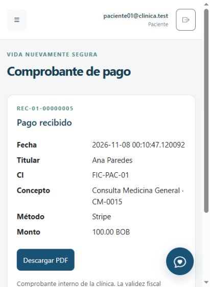
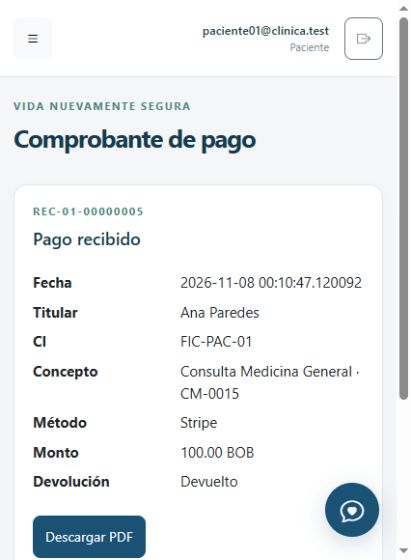

# Verificación de integraciones locales

Fecha: 8 de noviembre de 2026, zona horaria America/Caracas.

## Resultado

| Componente | Comprobación realizada | Estado |
| --- | --- | --- |
| Stripe Checkout | Reserva desde el portal del paciente, tarjeta de prueba, retorno a la aplicación y webhooks auténticos recibidos por Stripe CLI | Aprobado en modo de prueba |
| Pago y comprobante | 100,00 BOB; una sola fila de pago tras los dos eventos aceptados; cita confirmada y comprobante generado | Aprobado |
| Cancelación y devolución | Cancelación desde el Kardex, solicitud de devolución y ejecución de `clinica:devoluciones`; consulta posterior a Stripe | Aprobado: pago y devolución `succeeded`, `livemode=false` |
| Programador | `schedule:work` inició el despacho automático de confirmación y recordatorio por SMTP en una base aislada | Aprobado; proceso de prueba detenido al terminar |
| Brevo | Aceptó los dos avisos técnicos al remitente configurado; repetir el despacho no modificó las fechas de envío | Aceptación SMTP comprobada; llegada a la bandeja pendiente de confirmación del usuario |
| Gemini | API real con `gemini-3.5-flash`, razonamiento `high`; interpretación de filtros y consulta desde la pantalla del médico | Aprobado por entrada escrita |
| Angélica | Consulta de especialidades desde el chat del paciente | Aprobado; este flujo usa las respuestas de la aplicación, no Gemini |
| Perfiles | Regresión automatizada de permisos y vistas; recorrido manual del portal de paciente y del médico | Automatización aprobada; revisión visual completa de Administrador y Recepción pendiente |
| Micrófono | Captura física de voz y permiso del navegador | Pendiente de prueba con el usuario |

## Evidencia de Stripe Test

- Reserva ficticia **CM-0015**, paciente de demostración y médico de demostración.
- Comprobante **REC-01-00000005**, importe **100,00 BOB**.
- Stripe confirmó tanto el pago como la devolución íntegra de 10.000 unidades
  menores. Se comprobó por API que `livemode=false`.
- Estado final local: cita **Cancelada**, devolución **Devuelto**. El pago conserva
  su registro histórico y el comprobante; sólo existe un pago para la reserva.
- Los webhooks `payment_intent.succeeded` y `checkout.session.completed`
  respondieron HTTP 200. No se sustituyeron por eventos generados manualmente.
- La base local pasó de 14 a **15 citas** y de 4 a **5 pagos**, al agregar este
  caso ficticio. Los registros anteriores se conservaron.





## Programador y correo

La prueba utilizó `clinica_integraciones_20261108_v2_test`, con un paciente y un
médico ficticios. Se generaron los avisos desde una reserva real del servicio.
Se comprobó primero que el recordatorio tuviera fecha de despacho a las 24 horas
previas. Después se adelantó exclusivamente ese aviso de prueba para verificar
el envío sin esperar varios días.

`schedule:work` ejecutó el comando programado y Brevo aceptó confirmación y
recordatorio. Una segunda ejecución del despachador no los volvió a enviar.
Los asuntos son **Aviso de su cita médica**. El destinatario fue la dirección
configurada como remitente; no se usaron destinatarios de pacientes reales.

El trabajador de esta prueba se detuvo al terminar. No quedó activado un
programador permanente sobre `clinica_db`: esa base contiene cuatro avisos
pendientes de cuentas ficticias `@clinica.test`, que no son buzones reales.
El arranque normal de desarrollo es:

```powershell
& '.tools/php/php.exe' artisan schedule:work
```

Debe mantenerse abierto para ejecutar las tareas cada minuto. Antes de usarlo
con envío SMTP sobre la base de demostración, se deben revisar sus destinatarios.
Para un servidor permanente se requiere configurar la ejecución al iniciar el
servicio o el sistema operativo.

## Ajustes realizados y regresión

- `Paciente` ahora admite guardar `correo_contacto` mediante asignación masiva.
  Se agregó una prueba de paciente sin cuenta que recibe ambos avisos de reserva.
- La configuración de ejemplo y los valores predeterminados de Gemini coinciden
  con el modelo acordado: `gemini-3.5-flash` y nivel `high`.
- El intérprete recibe el catálogo de estados y normaliza plurales y variantes
  de género antes de consultar. Continúa rechazando estados ajenos al catálogo.
- La primera consulta real de planificación tardó 5,47 segundos. La pantalla del
  médico produjo después el reporte de la cita cancelada del 9 de noviembre,
  con un registro limitado al médico autenticado.
- Suite final en `clinica_revision_20261107_test`: **47 pruebas, 238 aserciones**,
  sin fallos, en 43,390 segundos. Véase [pruebas.xml](pruebas.xml).

La recepción de los correos y la captura con micrófono son comprobaciones
distintas de la aceptación SMTP y de la consulta escrita: no se dan por aprobadas.
